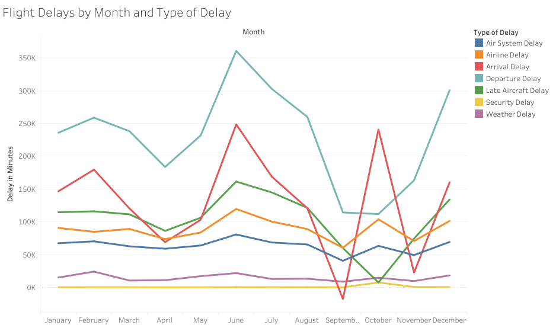
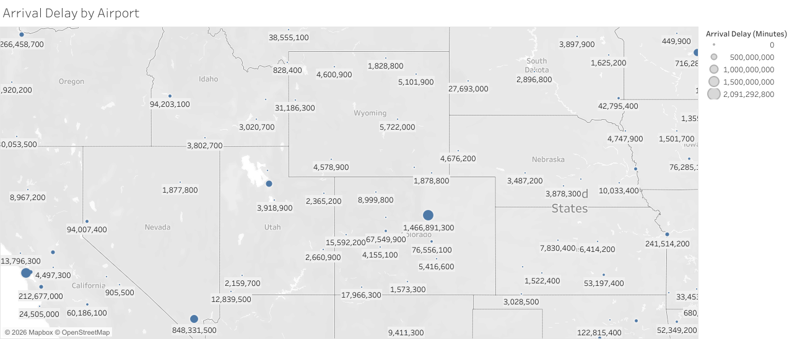

# US Flight Delay & Cancellation Analysis

## Project Overview

This project analyzes flight delays and cancellations across US airlines and airports using Tableau. The goal is to explore airline performance, identify monthly delay patterns, and understand geographic differences in flight delays.

Through interactive data visualizations, this project demonstrates how flight data can be transformed into meaningful insights to support data-driven decision-making.

## Business Objectives

- Compare total flight delay minutes across airlines.
- Identify flight cancellation patterns by airline and day of the week.
- Analyze monthly trends across different types of flight delays.
- Explore arrival delay distribution across US states.
- Compare arrival delays across airport locations.

## Tools & Technologies

- **Tableau Public:** Data visualization and analysis.
- **Microsoft Excel:** Data exploration and preparation.
- **CSV:** Data storage and input files.
- **GitHub:** Project documentation and version control.

## Data Visualizations

### 1. Total Airline Delays by Airline

Compares total accumulated delay minutes across airlines to identify which airlines experience the highest delay volumes.

### 2. Flight Cancellations by Airline and Day

A highlight table showing cancellation patterns across airlines and days of the week. Darker colors represent higher cancellation counts.

### 3. Flight Delays by Month and Type

A line chart comparing seven categories of flight delays across the months of the year.

### 4. Arrival Delay by State

A filled map illustrating the geographic distribution of accumulated arrival delay minutes across US states.

### 5. Arrival Delay by Airport

A symbol map displaying airport locations, with circle sizes representing accumulated arrival delay minutes.

## Key Findings

The visualizations allow us to investigate:

- Which airlines have the highest accumulated delay minutes.
- Which airlines and weekdays experience more cancellations.
- How different delay categories change throughout the year.
- Which states and airport locations have higher accumulated arrival delays.

*Specific numerical findings will be added after reviewing the underlying data and chart results.*

## Business Recommendations

- Monitor airlines with high accumulated delay minutes to identify operational improvement opportunities.
- Investigate weekday cancellation patterns to support better scheduling and resource planning.
- Examine monthly delay trends to anticipate periods of increased disruption.
- Use state-level and airport-level analysis to identify locations that
