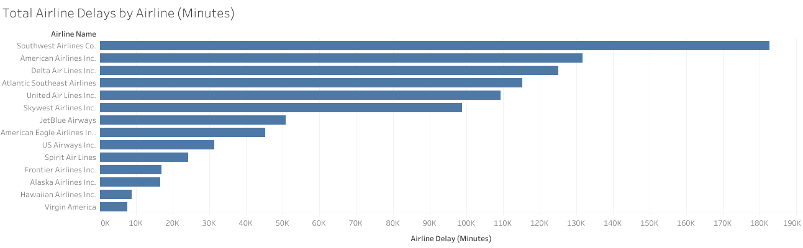
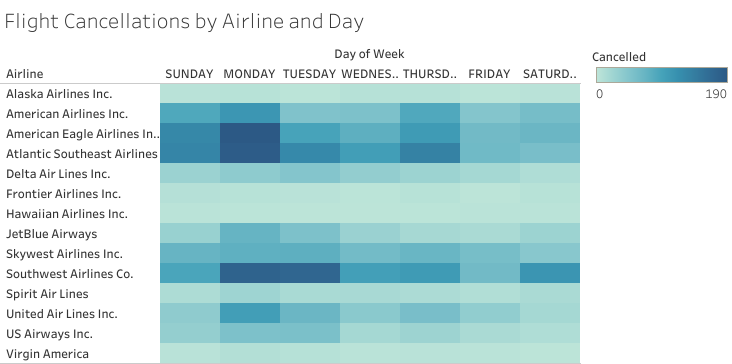
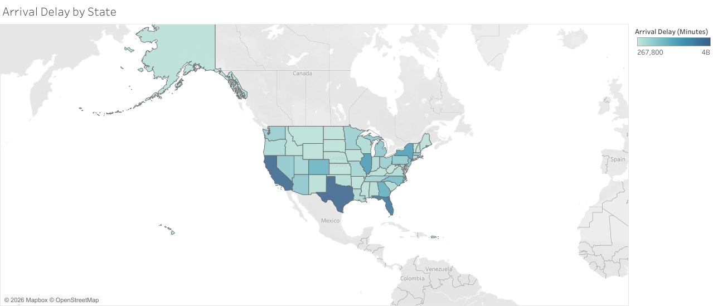

# US Flight Delay & Cancellation Analysis

## Project Overview

This project analyzes flight delays and cancellations across US airlines and airports using Tableau. The goal is to explore airline performance, identify monthly delay patterns, and understand geographic differences in flight delays.

Through interactive data visualizations, this project demonstrates how flight data can be transformed into meaningful insights to support data-driven decision-making.

## Interactive Tableau Dashboard

Explore the complete interactive dashboard on Tableau Public:

**[View Flight Delay & Cancellation Analysis](https://public.tableau.com/app/profile/abdur.rahim5381/viz/FlightDataset_17947270159490/Sheet1_1)**

The dashboard provides insights into:
- Total airline delays by airline.
- Flight cancellations by airline and day of the week.
- Monthly trends across seven delay categories.
- Arrival delay distribution across U.S. states.
- Arrival delay patterns across individual airports.

## Business Objectives

- Evaluate airline performance by comparing total accumulated flight delay minutes.
- Identify flight cancellation patterns across airlines and days of the week.
- Examine monthly trends across seven different flight delay categories.
- Analyze the geographic distribution of arrival delays across U.S. states.
- Identify airports with the highest accumulated arrival delay minutes.

## Tools & Technologies

- **Tableau Public:** Interactive data visualization and dashboard development.
- **Microsoft Excel:** Data exploration and preparation.
- **CSV:** Dataset storage and data input format.
- **GitHub:** Project documentation and version control.

## Data Visualizations

### 1. Total Airline Delays by Airline

Compares total accumulated delay minutes across airlines to identify which airlines experience the highest delay volumes.

### 2. Flight Cancellations by Airline and Day

A highlight table showing cancellation patterns across airlines and days of the week. Darker colors represent higher cancellation counts.

### 3. Flight Delays by Month and Type

A line chart comparing seven categories of flight delays across the months of the year.

### 4. Arrival Delay by State

A filled map illustrating the geographic distribution of accumulated arrival delay minutes across US states.

### 5. Arrival Delay by Airport

A symbol map displaying airport locations, with circle sizes representing accumulated arrival delay minutes.

## Key Findings

Based on the Tableau visualizations, the analysis highlights five key observations:

### 1. Airline Delay Performance

Southwest Airlines Co. recorded the highest accumulated airline delay minutes among the airlines shown in the comparison chart.

### 2. Flight Cancellation Patterns

The cancellation heatmap reveals variations in cancellation counts across airlines and days of the week. Some airline-day combinations show noticeably higher cancellation activity.

### 3. Monthly Delay Trends

Departure Delay represents the largest delay category in the monthly comparison, reaching its highest visible point in June.

### 4. Geographic Distribution of Arrival Delays

The state-level map highlights geographic differences in accumulated arrival delay minutes, with some states showing substantially higher totals than others.

### 5. Airport-Level Delay Distribution

The airport-level map reveals differences in accumulated arrival delay minutes across U.S. airports, helping identify locations with larger delay volumes.

**Important Note:** These findings are based on accumulated delay minutes and cancellation counts. Higher totals do not necessarily indicate worse operational performance, as flight volumes may differ between airlines and airports.

## Business Recommendations

Based on the analysis, the following actions could help airline operators improve operational performance:

1. **Monitor Airline Delays:** Investigate operational factors contributing to high accumulated delay minutes and identify opportunities to reduce delays.

2. **Improve Cancellation Management:** Review cancellation patterns by airline and weekday to support better scheduling and resource allocation.

3. **Prepare for Seasonal Disruptions:** Examine monthly delay trends to identify periods requiring additional operational planning.

4. **Prioritize High-Delay Locations:** Investigate states and airports with high accumulated arrival delay minutes to identify potential infrastructure or operational challenges.

5. **Strengthen Performance Monitoring:** Track delay and cancellation metrics regularly to evaluate operational improvements over time.
